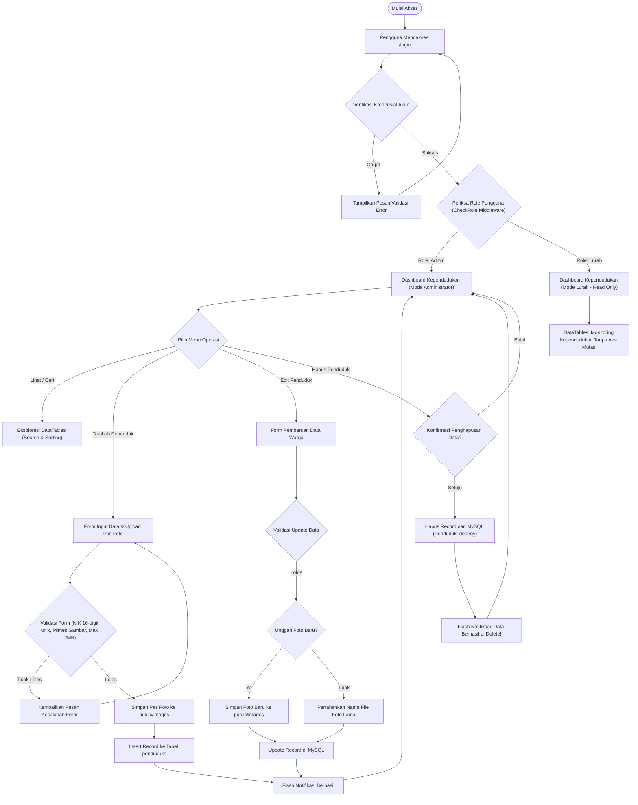
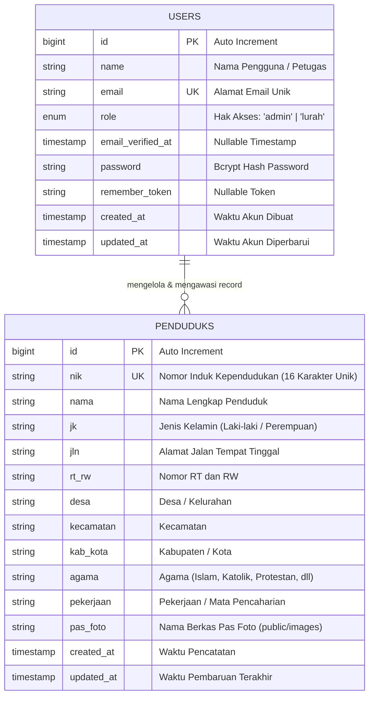

<div align="center">

# 🏛️ Sistem Informasi Pendataan Penduduk Desa & Kelurahan
### *Citizen Data & Demographics Management Information System*

[](https://laravel.com)
[](https://www.php.net)
[](https://getbootstrap.com)
[](https://www.mysql.com)
[](LICENSE)

<p align="center">
  Aplikasi web administrasi dan kependudukan tingkat desa/kelurahan yang dirancang untuk digitalisasi pencatatan data warga, penegakan integritas Nomor Induk Kependudukan (NIK 16-digit unik), pengarsipan identitas visual (pas foto), serta kontrol hak akses bertingkat (Role-Based Access Control) antara Administrator Desa dan Pimpinan Kelurahan (Lurah).
</p>

---

</div>

## 📌 Daftar Isi
- [Latar Belakang & Problem Statement](#-latar-belakang--problem-statement)
- [Arsitektur Sistem & Alur Pengelolaan Data](#-arsitektur-sistem--alur-pengelolaan-data)
- [Skema Basis Data (Entity Relationship Diagram)](#-skema-basis-data-entity-relationship-diagram)
- [Matriks Peran Pengguna (Role-Based Access Control)](#-matriks-peran-pengguna-role-based-access-control)
- [Fitur Utama Sistem](#-fitur-utama-sistem)
- [Akun Uji Coba Default (Seeder)](#-akun-uji-coba-default-seeder)
- [Panduan Instalasi & Menjalankan Lokal](#-panduan-instalasi--menjalankan-lokal)
- [Struktur Direktori Proyek](#-struktur-direktori-proyek)
- [Teknologi & Dependensi](#-teknologi--dependensi)
- [Kontribusi & Standar Kode](#-kontribusi--standar-kode)
- [Lisensi](#-lisensi)

---

## 💡 Latar Belakang & Problem Statement

Pencatatan administrasi kependudukan di tingkat kelurahan dan desa konvensional seringkali menghadapi berbagai kendala operasional:
1. **Risiko Duplikasi Identitas**: Pendataan manual atau spreadsheet rentan terhadap duplikasi nomor identitas (NIK) dan ketidaksinkronan format data kependudukan.
2. **Ketiadaan Pembagian Otoritas (RBAC)**: Staf operator data (Admin) dan penanggung jawab wilayah (Lurah/Kepala Desa) memerlukan visibilitas yang berbeda; pimpinan membutuhkan akses pengawasan tanpa risiko perubahan data tidak sengaja.
3. **Pencarian Data Lambat**: Menemukan data warga berdasarkan RT/RW, pekerjaan, atau agama membutuhkan waktu lama tanpa adanya sistem indeks dan filter dinamis.
4. **Arsip Visual yang Terpisah**: Pas foto dokumen kependudukan seringkali terpisah dari metadata teks warga, menyulitkan proses verifikasi fisik.

**Solusi Sistem**:
Sistem Informasi Pendataan Penduduk ini dibangun di atas Laravel 8 dengan menerapkan validasi integritas ketat (NIK 16 digit numerik unik), manajemen berkas pas foto terpusat, integrasi DataTables interaktif, serta middleware `CheckRole` yang memisahkan hak akses `admin` (CRUD penuh) dan `lurah` (monitoring read-only).

---

## 🔄 Arsitektur Sistem & Alur Pengelolaan Data

Aplikasi menggunakan pola arsitektur MVC (Model-View-Controller) khas Laravel yang diproteksi oleh HTTP Kernel Middleware stack.

### Alur Kerja Operasional Kependudukan



---

## 🗄️ Skema Basis Data (Entity Relationship Diagram)

Sistem menggunakan basis data relasional MySQL dengan skema yang memetakan akun otentikasi serta data demografi kependudukan desa.



### Detail Kamus Data Tabel `penduduks`

| Nama Kolom | Tipe Data | Atribut | Keterangan |
| :--- | :--- | :--- | :--- |
| `id` | `BIGINT UNSIGNED` | Primary Key, Auto Increment | Identifikator unik sistem internal |
| `nik` | `VARCHAR(255)` | Unique, Not Null | Nomor Induk Kependudukan (wajib 16 digit numerik) |
| `nama` | `VARCHAR(255)` | Not Null | Nama lengkap penduduk sesuai KTP/KK |
| `jk` | `VARCHAR(255)` | Not Null | Jenis kelamin (`Laki-laki` / `Perempuan`) |
| `jln` | `VARCHAR(255)` | Not Null | Alamat jalan domisili |
| `rt_rw` | `VARCHAR(255)` | Not Null | Wilayah rukun tetangga & rukun warga (misal: 002/005) |
| `desa` | `VARCHAR(255)` | Not Null | Nama kelurahan atau desa |
| `kecamatan` | `VARCHAR(255)` | Not Null | Nama kecamatan domisili |
| `kab_kota` | `VARCHAR(255)` | Not Null | Nama kabupaten atau kota |
| `agama` | `VARCHAR(255)` | Not Null | Agama yang dianut |
| `pekerjaan` | `VARCHAR(255)` | Not Null | Status profesi / bidang pekerjaan |
| `pas_foto` | `VARCHAR(255)` | Not Null | Nama berkas gambar pas foto penduduk di `public/images` |
| `created_at` | `TIMESTAMP` | Nullable | Waktu rekod kependudukan dibuat |
| `updated_at` | `TIMESTAMP` | Nullable | Waktu rekod kependudukan terakhir diperbarui |

---

## 👥 Matriks Peran Pengguna (Role-Based Access Control)

Aplikasi mengimplementasikan middleware khusus `CheckRole` (`app/Http/Middleware/CheckRole.php`) yang memeriksa atribut `role` pengguna pada sesi aktif.

| Fitur / Hak Akses | Administrator Desa (`admin`) | Kepala Desa / Lurah (`lurah`) | Tamu / Publik (`guest`) |
| :--- | :---: | :---: | :---: |
| Akses Halaman Login | ✅ | ✅ | ✅ |
| Registrasi Mandiri Publik | ❌ *(Dinonaktifkan)* | ❌ *(Dinonaktifkan)* | ❌ *(Dinonaktifkan)* |
| Melihat Dashboard Kependudukan | ✅ | ✅ | ❌ *(Redirect /login)* |
| Pencarian & Filter Data Warga | ✅ | ✅ | ❌ |
| Preview Pas Foto Warga | ✅ | ✅ | ❌ |
| Tambah Data Penduduk Baru | ✅ | ❌ *(Restricted)* | ❌ |
| Edit Data Penduduk Eksisting | ✅ | ❌ *(Restricted)* | ❌ |
| Ganti Pas Foto Penduduk | ✅ | ❌ *(Restricted)* | ❌ |
| Hapus Data Penduduk | ✅ | ❌ *(Restricted)* | ❌ |

---

## ✨ Fitur Utama Sistem

- 🪪 **Validasi Integritas NIK 16-Digit**: Validasi server-side otomatis pada `AdminController` memastikan format numerik persis 16 angka dan menolak duplikasi NIK (`unique:penduduks`).
- 🖼️ **Manajemen Berkas Pas Foto Terintegrasi**: Pengunggahan foto warga dengan validasi tipe MIME (`jpeg, bmp, jpg, PNG, gif, png`) dan pembatasan kapasitas maksimal 2 MB, disimpan ke penyimpanan statis publik.
- 🔍 **Eksplorasi Data Dinamis via jQuery DataTables**:
  - Pencarian instan multi-kolom (berdasarkan NIK, nama, alamat, RT/RW, dsb).
  - Pengurutan data (sorting) real-time.
  - Horizontal scroll table (`scrollX: true`) untuk kemudahan navigasi data berbidang lebar.
- 🛡️ **Proteksi Keamanan Berlapis**:
  - Perlindungan Cross-Site Request Forgery (`@csrf`) pada seluruh mutasi data POST, PATCH, dan DELETE.
  - Penonaktifan rute registrasi terbuka untuk mencegah pihak luar membuat akun tanpa izin resmi kelurahan.
  - Hash kata sandi terstandar industri (Bcrypt/Argon2).
- 📱 **Antarmuka Bersih & Responsif**: Berbasis Bootstrap dengan layout kartu modular, navigasi dropdown akun, serta indikator umpan balik status tindakan (*success/danger alert*).

---

## 🔑 Akun Uji Coba Default (Seeder)

Setelah menjalankan `php artisan db:seed`, sistem menyediakan dua akun pengujian default:

| Role | Nama Akun | Email | Password Default | Izin Akses |
| :--- | :--- | :--- | :--- | :--- |
| **Administrator** | `Admin` | `admin@gmail.com` | `admin123` | CRUD Penuh (Create, Read, Update, Delete) |
| **Lurah** | `Lurah` | `lurah@gmail.com` | `lurah123` | Read-Only (Monitoring Dashboard & DataTables) |

> [!IMPORTANT]
> Untuk penggunaan lingkungan produksi, segera ubah kombinasi email dan kata sandi default melalui `php artisan tinker` atau antarmuka basis data.

---

## 🚀 Panduan Instalasi & Menjalankan Lokal

Ikuti langkah-langkah di bawah ini untuk menyiapkan dan menjalankan proyek di lingkungan pengembangan lokal:

### 1. Prasyarat Sistem
- **PHP**: Versi `^7.3` atau `^8.0` (disertai ekstensi `pdo_mysql`, `mbstring`, `openssl`, `tokenizer`, `xml`, `ctype`, `json`, `fileinfo`)
- **Composer**: Versi 2.x
- **Node.js & NPM**: Node.js 14.x/16.x/18.x dan NPM
- **MySQL / MariaDB**: Versi 5.7+ atau 8.0+

### 2. Kloning Repositori
```bash
git clone https://github.com/fauzanlm/Pendataan_Penduduk_in_laravel8.git
cd Pendataan_Penduduk_in_laravel8
```

### 3. Instalasi Dependensi Backend (Composer)
```bash
composer install
```

### 4. Instalasi & Kompilasi Aset Frontend (NPM)
```bash
npm install
npm run dev
```

### 5. Konfigurasi Lingkungan (`.env`)
Salin file konfigurasi contoh dan buat file `.env` baru:
```bash
cp .env.example .env
```
Sesuaikan parameter koneksi basis data di dalam file `.env`:
```env
DB_CONNECTION=mysql
DB_HOST=127.0.0.1
DB_PORT=3306
DB_DATABASE=db_pendataan_penduduk
DB_USERNAME=root
DB_PASSWORD=
```
Pastikan basis data dengan nama `db_pendataan_penduduk` telah dibuat di server MySQL Anda:
```sql
CREATE DATABASE db_pendataan_penduduk CHARACTER SET utf8mb4 COLLATE utf8mb4_unicode_ci;
```

### 6. Generate Kunci Enkripsi Aplikasi
```bash
php artisan key:generate
```

### 7. Eksekusi Migrasi & Database Seeder
Jalankan migrasi skema tabel beserta pengisian data akun bawaan:
```bash
php artisan migrate --seed
```

### 8. Menjalankan Server Aplikasi
Jalankan server pengembangan Laravel:
```bash
php artisan serve
```
Akses aplikasi melalui peramban web di:
```
http://127.0.0.1:8000
```
Gunakan akun uji coba [di atas](#-akun-uji-coba-default-seeder) untuk masuk ke dalam sistem.

---

## 📂 Struktur Direktori Proyek

Ringkasan komponen inti dari arsitektur proyek:

```text
Pendataan_Penduduk_in_laravel8/
├── app/
│   ├── Http/
│   │   ├── Controllers/
│   │   │   ├── AdminController.php      # Pengendali CRUD data penduduk (role:admin)
│   │   │   ├── HomeController.php       # Dashboard monitoring kependudukan (role:admin,lurah)
│   │   │   └── Auth/                   # Kontroler otentikasi login & logout
│   │   ├── Middleware/
│   │   │   ├── Authenticate.php         # Verifikasi sesi pengguna aktif
│   │   │   └── CheckRole.php            # Verifikasi role pengguna (RBAC)
│   │   └── Kernel.php                   # Pendaftaran middleware stack & alias
│   └── Models/
│       ├── Penduduk.php                 # Eloquent Model entitas penduduk desa
│       └── User.php                     # Eloquent Model entitas pengguna sistem
├── database/
│   ├── migrations/
│   │   ├── 2014_10_12_000000_create_users_table.php
│   │   ├── 2021_06_19_025840_create_penduduks_table.php
│   │   └── 2021_07_21_033459_add_column_to_users_table.php
│   └── seeders/
│       ├── DatabaseSeeder.php           # Master seeder runner
│       ├── createAdmin.php              # Seeder akun admin
│       └── createLurah.php              # Seeder akun lurah
├── public/
│   ├── css/                             # Stylesheet Bootstrap & DataTables
│   ├── images/                          # Direktori penyimpanan pas foto warga
│   └── js/                              # Script jQuery & jQuery DataTables
├── resources/
│   └── views/
│       ├── auth/login.blade.php         # Tampilan antarmuka login
│       ├── layouts/app.blade.php        # Layout induk aplikasi (navbar & script table)
│       ├── penduduk/
│       │   ├── create.blade.php         # Formulir tambah warga & upload pas foto
│       │   └── edit.blade.php           # Formulir pembaruan warga & pas foto
│       └── home.blade.php               # Tampilan dashboard tabel kependudukan
├── routes/
│   └── web.php                          # Rute aplikasi web & pengikatan middleware
├── .env.example                         # Templat konfigurasi lingkungan
├── composer.json                        # Definisi paket & dependensi PHP
└── package.json                         # Definisi paket aset JavaScript/Sass
```

---

## 🛠️ Teknologi & Dependensi

- **Core Framework**: [Laravel 8.12](https://laravel.com)
- **Programming Language**: [PHP 7.3+ / 8.0+](https://www.php.net)
- **Database Engine**: [MySQL](https://www.mysql.com)
- **Frontend Framework**: [Bootstrap 4.x / 5.0](https://getbootstrap.com)
- **Interactive Table**: [jQuery 3.5.1](https://jquery.com) & [DataTables](https://datatables.net)
- **UI Scaffold**: `laravel/ui 3.2`
- **Asset Bundler**: Laravel Mix 6.0 & Webpack

---

## 🤝 Kontribusi & Standar Kode

Kontribusi untuk perbaikan bug dan peningkatan sistem kependudukan sangat diapresiasi:
1. Fork repositori ini.
2. Buat branch fitur baru (`git checkout -b feature/nama-fitur`).
3. Pastikan penulisan kode mematuhi standar PSR-12.
4. Gunakan pesan commit dengan format [Conventional Commits](https://www.conventionalcommits.org/):
   - `feat: tambah fitur export laporan format excel`
   - `fix: perbaiki validasi ekstensi pas foto`
   - `docs: perbarui dokumentasi arsitektur`
5. Push branch Anda (`git push origin feature/nama-fitur`).
6. Buka Pull Request ke branch `master`.

---

## 📄 Lisensi

Aplikasi ini didistribusikan di bawah lisensi terbuka [MIT License](LICENSE). Bebas digunakan dan dikembangkan untuk keperluan instansi pemerintahan, desa, kelurahan, maupun institusi akademik.
